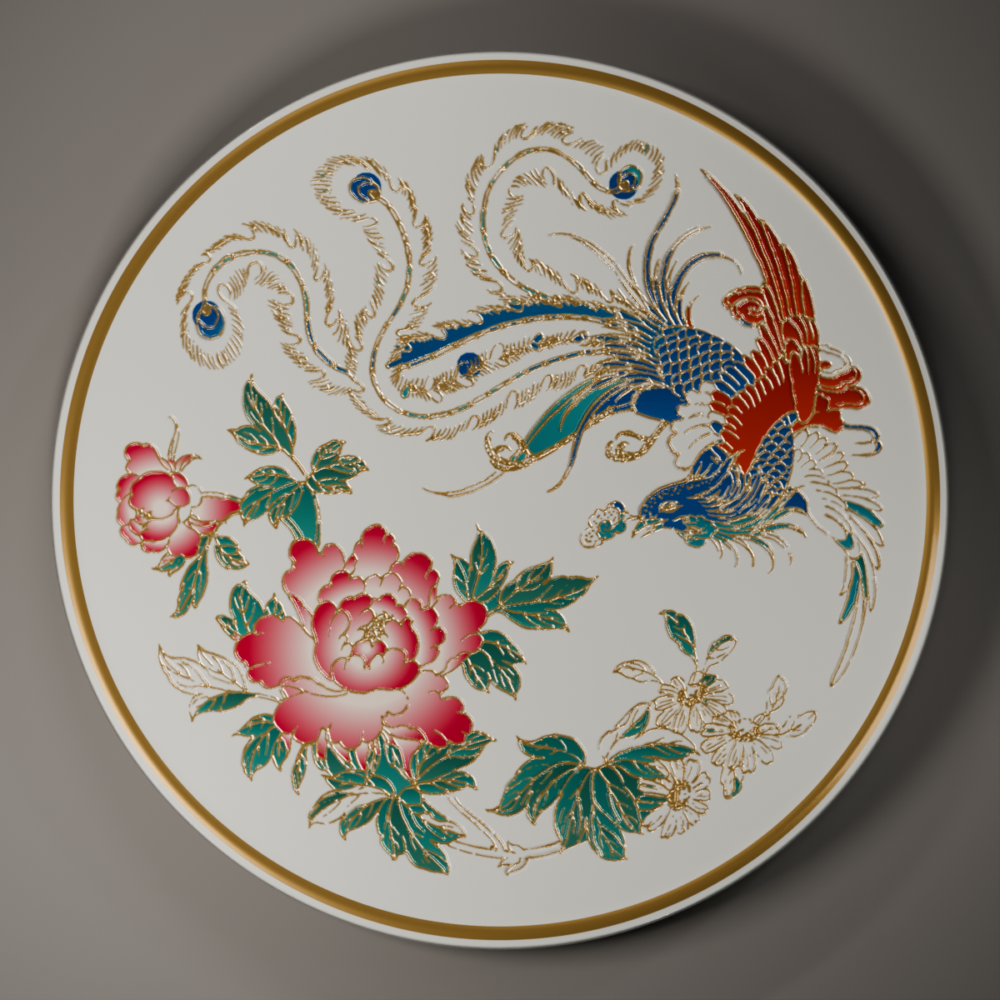
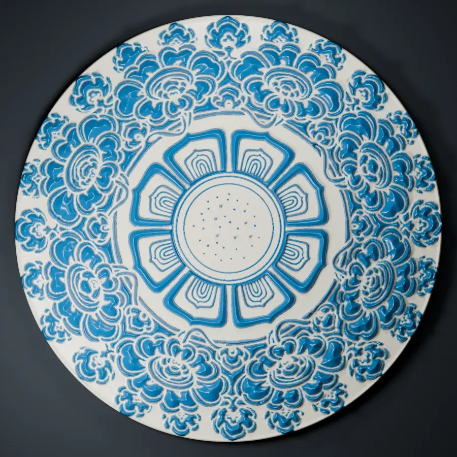
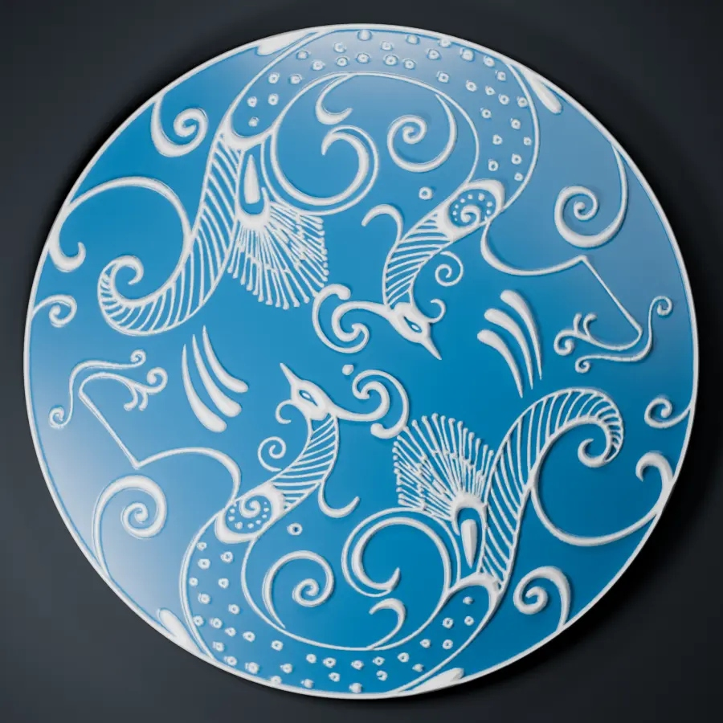
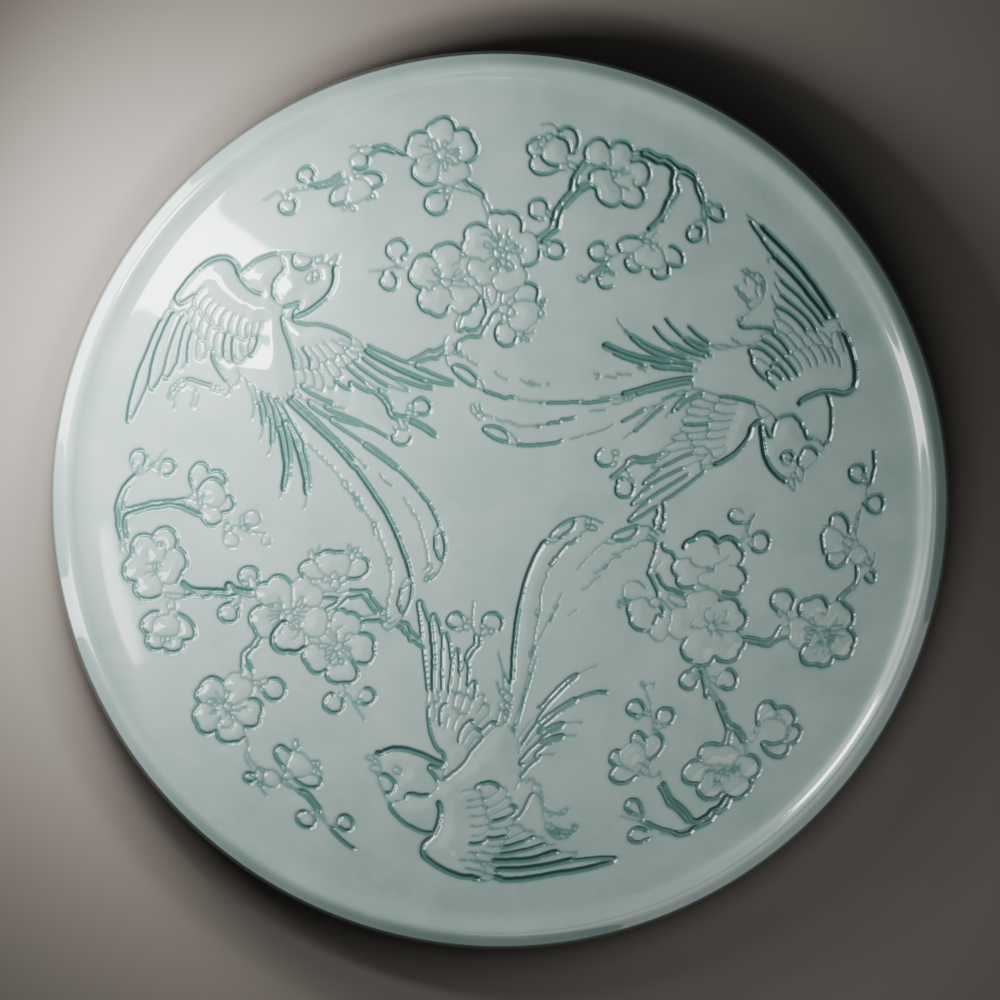

# OrnamentForge

> **An open-source Codex Skill for turning ornamental references and
> creative ideas into editable 3D assets in Blender.**
>
> Reference image or text prompt → 2D ornament design → editable Blender
> asset

[English](README.md) | [简体中文](README.zh-CN.md)

OrnamentForge is an experimental open-source project by **Yifan Zhi Tuan
/ PaperBall (一番纸团)**. It explores how intricate ornamental designs
can be reconstructed and turned into editable Blender assets, rather
than remaining flat pattern images.

Version 1 primarily focuses on traditional Chinese ornamentation,
ceramic engraving, shallow and layered relief, painted ceramics,
repeating decorative patterns, plates, ceramic cups, simple rotational
vases, and planar surfaces.

## Showcase

| Painted Phoenix-and-Peony Plate | Blue-and-White Lotus Medallion Plate |
|:---:|:---:|
|  |  |

| Phoenix Line-Relief Plate | Qingbai Engraved Bird-and-Flower Plate |
|:---:|:---:|
|  |  |

## Workflow

```text
Reference Image or Natural-Language Prompt
                    ↓
             2D Ornament Design
                    ↓
            Fidelity Reconstruction
                    ↓
                PlanarMaster
                    ↓
              SurfaceMap / Craft
                    ↓
           Editable Asset in Blender
```

## Key Features

### Reference-Based Reconstruction

When a reference image is provided, OrnamentForge prioritizes
reconstruction over redesign. It aims to preserve motif shapes, element
placement, proportions, composition, line structure, visual hierarchy,
and major color relationships. Suitable inputs include black-and-white
line art, colorful traditional patterns, floral and bird motifs,
geometric ornaments, ceramic decoration, engraving designs, and relief
references.

### Natural-Language Design

If you do not have a reference image, describe the object and pattern
you want. The workflow uses the image-generation capability available in
the current Codex session to create 2D ornament candidates, then
continues with reconstruction, surface mapping, craft operations, and
Blender output.

If image generation is unavailable in the current Codex session, the
workflow returns `AI_IMAGE_TOOL_UNAVAILABLE / HOLD` rather than silently
switching to another generation method.

### Ceramic Engraving and Relief

OrnamentForge can turn line art and decorative patterns into shallow
engraved or recessed geometry. It also supports layered relief, floral
relief, monochrome relief from color references, and combinations of
painted patterns and relief.

### Painted Ceramics

Color references can be mapped onto ceramic surfaces while aiming to
preserve the original motifs, composition, element placement,
proportions, and major color relationships.

**Note:** Painted details may remain texture-based. An editable Blender
asset does not mean every colored region has become independent vector
geometry.

### Supported Surfaces and Materials

Version 1 primarily supports planes, cylinders, cones, simple rotational
vases, existing plate and shallow-bowl mapping workflows, and a limited
set of existing UV meshes.

Ceramic presentation presets include `QINGBAI_GLAZE` and
`YINGQING_GLAZE`, designed for qingbai-style glaze color, soft
translucency, clear coat, glaze accumulation in engraved grooves,
reflections, rim highlights, grazing light, and AgX color management.

The SurfaceMap workflow tracks seams, parameter-domain correspondence,
`Tu / Tv / Normal`, source correspondence, and distortion QA. If mapping
distortion exceeds the allowed threshold, the workflow may enter `HOLD`
rather than force an unreliable result.

## Installation

### Requirements

- Python 3.11+
- Blender 4.2+
- Codex

The main validation environment includes Blender 5.1.2.

### Option 1: Clone the Repository

Run this command in the project where you want to use the Skill:

``` bash
git clone https://github.com/YifanZhiTuan/OrnamentForge.git .agents/skills/ornamentforge
```

Then invoke the Skill in Codex:

```text
$ornamentforge
```

### Option 2: Download a Release

1.  Open the repository's **Releases** page.
2.  Download the OrnamentForge Skill archive.
3.  Extract it so the Skill root contains `SKILL.md`, `agents/`,
    `references/`, and `scripts/`.
4.  Place the folder in a Skill directory accessible to Codex.

### Python Environment

We recommend creating a separate Python environment outside the Skill
folder. From the Skill root, install dependencies:

``` bash
pip install -r scripts/requirements.txt
```

Initialize a workspace:

``` bash
python scripts/run.py --workspace <WORKSPACE> init
```

Check the CLI:

``` bash
python scripts/run.py --workspace <WORKSPACE> cli --help
```

See [`references/setup.md`](references/setup.md) for more details.

## Usage

In Codex, invoke the Skill with `$ornamentforge`, then describe your
task.

### With a Reference Image

```text
Use $ornamentforge.

Turn the uploaded reference into ceramic engraving.
Preserve the original motifs, proportions, and composition as closely
as possible. Do not redesign the pattern.

Export an editable Blender file and final renders.
```

### Without a Reference Image

```text
Use $ornamentforge.

Create an engraved qingbai porcelain vase featuring two dragons
circling a central pearl. Keep the style traditional but refined.

Export an editable Blender file and final renders.
```

## Example Prompts

**Dragon-and-pearl vase**

```text
Use $ornamentforge.

Create an engraved qingbai porcelain vase with two dragons circling
a central pearl. Keep the style traditional and refined.

Export an editable Blender file and front, three-quarter, and detail renders.
```

**Lotus medallion plate**

```text
Use $ornamentforge.

Create a qingbai porcelain plate with a lotus medallion. Place a lotus
flower in the center, surrounded by lotus leaves and vines. Keep the
composition balanced and avoid overcrowding.

Use shallow engraving and export the Blender file and final renders.
```

**Repeating cloud-motif cup**

```text
Use $ornamentforge.

Create a qingbai ceramic cup with a continuous cloud pattern around the
body. Keep the design simple and make the pattern seam unobtrusive.

Use shallow engraving and export the Blender file and final renders.
```

**Colorful pattern to relief**

```text
Use $ornamentforge.

Turn the uploaded colorful pattern into ceramic relief. Preserve its
motifs and overall layout. Use the colors to identify visual hierarchy,
then translate that hierarchy into different relief heights.

Export an editable Blender file and final renders.
```

## Current Limitations

OrnamentForge V1 is **not** a general-purpose system that can generate
any 3D model from any prompt.

Current limitations include: - No automatic unwrapping for arbitrary
freeform surfaces - No general-purpose automatic UV unwrapping - Sphere
is not yet a formal SurfaceMap V1 target - No automatic multi-chart
mapping or advanced seam optimization - No general-purpose global
geodesic solver - No guarantee that every freeform vase can be mapped
automatically - No manufacturing-grade mold validation or prediction of
actual ceramic firing results - No automatic verification of a pattern's
historical authenticity or age - AI-generated patterns may contain
visual errors - Very fine line art may show aliasing or local detail
loss - Complex surface mapping may trigger a distortion `HOLD` - Glaze
reflections may affect perceived colors

When a task cannot be completed reliably, the workflow may return `HOLD`
or `NOT_SUPPORTED`. These are intentional quality-control outcomes; the
Skill does not lower QA standards simply to force a result.

## Validation Scenarios

Version 1 has completed multiple independent black-box tests,
including: - Dragon-and-pearl design → engraved qingbai vase - Lotus
medallion → engraved qingbai plate - Repeating cloud motif → shallow
engraving around a ceramic cup - Black-and-white bird-and-flower
reference → ceramic engraving - Color reference → painted ceramic -
Color reference → monochrome relief - Color reference → combined
painting and relief

## License

OrnamentForge uses separate licenses for different parts of the project.

- **Code and documentation:** primarily licensed under the MIT License.
  See [`LICENSE`](LICENSE).
- **Original patterns and reusable assets:** assets explicitly
  identified as original OrnamentForge work and approved for
  redistribution use the Creative Commons Attribution 4.0 International
  (CC BY 4.0) license. Attribution is required. See
  [`LICENSE-ASSETS.md`](LICENSE-ASSETS.md).
- **Third-party dependencies:** remain subject to their respective
  licenses. See [`THIRD_PARTY_NOTICES.md`](THIRD_PARTY_NOTICES.md).

The repository's licenses do not automatically cover external ArtLibrary
references, third-party ornamental images, user-uploaded references, AI
test images, historical run outputs, rendered Blender showcase works, or
user-generated works. Rights for those materials depend on their
original sources and applicable permissions.

## Version and Project Direction

**OrnamentForge v1.0.0**

Version 1 focuses on two core entry points:

```text
Reference Image → Fidelity Reconstruction → 3D Asset

Natural-Language Prompt → AI Ornament Design
                       → Fidelity Reconstruction
                       → 3D Asset
```

OrnamentForge is an experimental open-source project by **Yifan Zhi Tuan
/ PaperBall (一番纸团)**. It explores how traditional ornamentation can
move beyond a generated image and become editable, mappable, reusable 3D
assets.

Future development will focus on higher-fidelity reconstruction, more
reliable processing of intricate line art, more natural relief
structures, additional surface types, more realistic ceramic materials,
more complete automated QA, and better editability in Blender.

If you encounter a bug, have a feature request, or want to suggest a new
ornament-modeling use case, feel free to open a GitHub Issue.

------------------------------------------------------------------------

**Created by Yifan Zhi Tuan / PaperBall (一番纸团)**  
**OrnamentForge v1.0.0**
